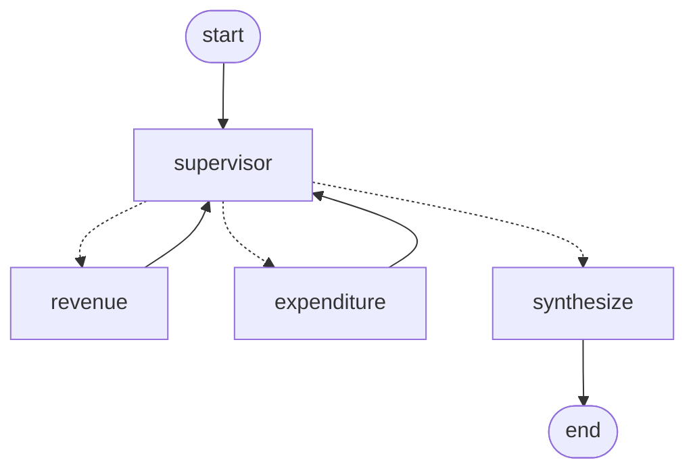

# HTX AI Engineering Take-Home

This project extracts structured data from Singapore Ministry of Finance (MOF) *Analysis of Revenue and Expenditure* PDFs, then reasons over that data with LLMs. It has three parts: document extraction (Part 1), tool calling and date reasoning (Part 2), and a multi-agent supervisor (Part 3).

## Getting started

### Prerequisites
- Python 3.12
- [uv](https://docs.astral.sh/uv/)
- An API key for an LLM provider

### Setup
1. **Install dependencies.**
   ```bash
   uv sync
   ```
2. **Set your API key** in the `API_KEY` environment variable. The same variable is used whatever the provider, and keys are never read from `config.yaml`, so they can't be committed by accident.
   ```bash
   export API_KEY="YOUR_KEY_HERE"
   ```
3. **Edit `config.yaml`** if needed. Every configuration in the file can be changed and it's the only file you need to change:
   ```yaml
   llm:
     provider: google_genai
     model: gemini-3.8-flash
   ```
   To use a different provider, change `provider` and `model` (e.g. `anthropic` with a Claude model) and put that provider's key in `API_KEY`. Keyless providers (`ollama`, `google_vertexai`, `bedrock_converse`) ignore `API_KEY`. The supported providers are listed in `PROVIDER_PACKAGES` in `llm.py`. The provider's LangChain package installs itself on the first run; set `llm.auto_install: false` to turn that off.

---

## How to run

### Part 1 — Document extraction
CLI (`--pdf` is required):
```bash
uv run htx-ai-technical part1 --pdf data/fy2024_analysis_of_revenue_and_expenditure.pdf
```
The PDF path is used as given, so a relative path is relative to where you run from (run from the repo root).

**Outputs:**
- `outputs/part1_fy<year>.json` holds the extracted fields and their provenance.
- `data/processed/<pdf-name>.json` is the cached parsed document. It's reused by every part whenever a file of that name exists, even if the PDF has changed; delete it to re-parse (e.g. after replacing the PDF with a new file of the same name, or changing `parsing.py`).

### Part 2 — Tool calling and reasoning
CLI (`--pdf` and `--reference-date` are required):
```bash
uv run htx-ai-technical part2 --pdf data/fy2024_analysis_of_revenue_and_expenditure.pdf --reference-date 2024-01-01
```
`run_part2` starts the local MCP server itself (as a subprocess over stdio), so there's nothing else to run.

**Outputs:** `outputs/part2_<pdf-name>_ref<reference-date>.json` (e.g. `part2_fy2024_analysis_of_revenue_and_expenditure_ref2024-01-01.json`) holds the classified dates, the list of normalised dates, every tool call the LLM made, the provenance of each date, and an `error` if the extraction agent gave no valid answer. The CLI prints the same trace: dates found → tool calls → normalised dates → statuses.

### Part 3 — Multi-agent supervisor
CLI (`--pdf` and `--query` are required):
```bash
uv run htx-ai-technical part3 --pdf data/fy2024_analysis_of_revenue_and_expenditure.pdf \
  --query "What are the key government revenue streams, and how will the Budget for the Future Energy Fund be supported?"
```
**Outputs:** `outputs/part3_fy<year>_<query-slug>.json` holds the final answer and the full trace (`steps`): every supervisor decision (its reasoning, the agent chosen and the task written for it) and every agent run (its task, tool calls and report with figures and pages). The CLI prints the same trace in order: decision → tool calls → report → … → final answer.

## Architecture

### Part 1 pipeline
```
PDF ─▶ parse (Docling) + cache ─▶ blocks ─▶ locate ─▶ extract (LLM) ─▶ Part1Result + JSON
```

1. **Parse** (`parsing.py`). Converts the PDF into **blocks**. Each block records the pages it spans. Detects the fiscal year from the cover. Caches the result as `data/processed/<pdf-name>.json`, keyed by the PDF's filename (not its contents).
2. **Locate** (`retrieval.py`). Finds the block for each field group by matching an **anchor pattern** (e.g. `Budget for FY{fy}`) against block titles, taking the first match in document order. Only anchors are used; there is no fallback.
3. **Extract** (`extraction.py`). One LCEL chain (`prompt | llm.with_structured_output(Schema)`) per field group, run in parallel with `.batch()`. Each LLM call is logged with its latency, tokens and cost.

### Part 2 pipeline
```
blocks ─▶ locate (anchors) ─▶ step 1: find dates + normalize_date ─▶ step 2: classify (LLM reasoning) ─▶ Part2Result + JSON
                                                    └─ local MCP server (stdio)
```
1. **Locate** (`fields.py`, reusing `extraction.locate_block`). Each Part 2 field group's anchor finds its source block. The groups' field descriptions say what date to find.

   | Field | Located via | FY2024 text |
   |---|---|---|
   | `distribution_date` | the `(cover)` block | "Distributed on Budget Day: 16 February 2024" |
   | `estate_duty_date` | section `Asset* Taxes` (glossary; "Assets Taxes" up to FY2025, "Asset Taxes" in FY2026) | "Estate Duty does not apply to a person who dies after 15 February 2008." |
2. **Extract and normalise** (`dates.py`, `prompts/date_extraction.yaml`). An agent (`langchain.agents.create_agent`) given only the normalisation tool, with `NormalisedDates` as its structured output. The human prompt carries the fiscal year, the field definitions and the two located blocks. The LLM finds each date, quotes its sentence verbatim, and works out that it should call the tool on the date as printed. It reports the tool's output, never formatting a date itself. Its result is the list of normalised dates. The agent is capped at `MAX_MODEL_CALLS` (6) model calls; a normal run takes 2. The last allowed call must answer (`AnswerOnLastCall`): its tools are taken away, `NormalisedDates` is forced, and a note tells the model to answer from the tool results it has. Only if that answer is invalid does the run end with no dates, its tool calls in `tool_calls` and the reason in `error`.
3. **Classify** (`dates.py`, `prompts/date_classification.yaml`). An LCEL chain with no tools (`prompt | llm.with_structured_output(Classifications)`). The human prompt carries the reference date (`--reference-date`; the brief uses `2024-01-01`) and the extraction step's output: each normalised date with its context sentence. The system prompt gives the brief's status definitions and walks the LLM through the reasoning: the subject of the sentence, whether the date marks an event or the start or end of a period, and how it compares with the reference date. The schema puts `reasoning` before `status`, so the model reasons before it answers.

### MCP server (`mcp_server.py`)
A [FastMCP](https://github.com/modelcontextprotocol/python-sdk) server over stdio, loaded into LangChain with `langchain-mcp-adapters`.

| Tool | Input | Output |
|---|---|---|
| `normalize_date` | `date_text`, e.g. "16 February 2024" | `"2024-02-16"`. Parsed with `dateutil`, day first. Raises an error unless the text has a day, a month and a year. |

The tool is deterministic: date parsing is done in code, which is reliable where LLMs occasionally slip. The LLM finds the dates and decides when to call the tool and with what input. A tool error goes back to the LLM as a message, so it can retry with a cleaner input. The tool is a plain function as well, so it is unit-tested without MCP.

### Part 3 pipeline

A hand-built LangGraph `StateGraph` (`supervisor.py`; the diagram is `build_graph(...).get_graph().draw_mermaid()`). The state is the query, the fiscal year, a list of `steps` that every node appends to, and the final answer.

1. **Supervisor** (`prompts/supervisor.yaml`). An LCEL call with structured output, `Route{reasoning, next, task}`. It sees the query and every report so far, lists the parts of the query, and either picks the agent for a part that isn't covered yet, writing a self-contained task for it, or finishes. `reasoning` comes before `next` in the schema, so the model reasons before it routes, and each decision's reasoning is in the trace. After `MAX_AGENT_CALLS` (4) agent runs the supervisor finishes without asking the LLM, so a confused run can't loop.
2. **Revenue Agent / Expenditure Agent** (`prompts/revenue_agent.yaml`, `prompts/expenditure_agent.yaml`). Each is a `create_agent` tool loop with `AgentReport{answer, figures[], gaps}` as structured output. Each figure is in $ billions with its block ids and pages. An agent sees only the supervisor's task, not the query or the other agent's reports, so its context stays small and focused. The prompts differ in scope (revenue: Operating Revenue, taxes, NIRC; expenditure: spending, Special Transfers, fund top-ups, fiscal position). Each agent run is capped at `MAX_AGENT_MODEL_CALLS` (8) model calls. The last allowed call must write the report from what the agent has read, the same way as Part 2's `AnswerOnLastCall`, so its figures are cited as usual. Its note also asks the agent to list under `gaps` anything the task asked for that it hasn't found yet, so the supervisor sees a report cut short by the cap and can follow it up. If that report is invalid, the agent's report keeps the answer and gaps it tried to write but drops its figures, and says so under `gaps`, so the supervisor can follow up for the figures. An agent that fails with an error is recorded in the trace with the error under `gaps`, and the supervisor carries on.
3. **Synthesize** (`prompts/synthesis.yaml`). One LLM call writes the final answer from the reports only. Every number must come from a report's figures, with its page, and the answer must not claim a link the reports don't support. It also gets the supervisor's reason for finishing, to tell two cases apart:
   - **Off-topic** (e.g. public holidays): the supervisor finishes without calling an agent, and the answer says the question is outside what it can answer.
   - **On topic but not in the document** (e.g. a FY2030 budget): the supervisor must call at least one agent first, since only an agent that searched can say the information is missing. The answer then says the document doesn't cover it.

## Assumptions
- This is not a once-time task and there may be a need to execute the same tasks on the reports from other years, so the implementation was designed to be year agnostic.
- First page of the document does not change across different years.

## Future Improvements
- Testing to check compatability with other LLM API providers.
- Spend more time on the evals, for part 3 in particular. As the output for part 3 is an open-ended response, a LLM-as-a-judge evaluation technique might be more suitable.

## Testing
```bash
uv run pytest
```
The tests need no API key and no PDF:
- `tests/test_retrieval.py`: anchor pattern matching, `locate` returning matches in document order, filtered by block type, and the Part 3 lookups: `list_blocks`, `read_blocks` (order, unknown ids, empty list) and `search` ranking.
- `tests/test_extraction.py`: `locate_block` taking the first anchor match (or none), the prompt's field definitions, and `field_answers` building provenance for answered and failed groups.
- `tests/test_parsing.py`: heading levels, fiscal-year detection, and table-to-markdown rendering.
- `tests/test_llm_logging.py`: the logged tokens, cost and metadata, and the warning for a failed call, using LangChain's fake chat model.
- `tests/test_evals.py`: the eval's comparison rules (number tolerance, null values, taxes list in any order) and Part 3 case scoring.
- `tests/test_mcp_server.py`: `normalize_date` on full, partial and invalid dates.
- `tests/test_dates.py`: the Part 2 anchors, provenance for found, missing and unlocated dates, the tool-call trace (which skips the agent's structured-output call), the model-call cap stopping a model that never stops calling tools while keeping its tool-call trace, and the last allowed call being made to answer, in both async (Part 2) and sync (Part 3) agents.
- `tests/test_supervisor.py`: `sum_values`, routing after each decision, how reports are rendered for the prompts, the report kept from an agent's invalid last report (its answer and gaps, without figures), and the agent-call limit (the supervisor finishes without an LLM call), using a fake chat model.

### Evals
Expected answers per PDF live in `evals/part1_cases.json`, with each `pdf_path` relative to the repo root. The eval runs Part 1 on every case (this needs `API_KEY`):
```bash
uv run python -m evals.part1_eval
```
Numbers pass within ±0.005, and the taxes list passes when it names the same taxes in any order (ignoring case). The report is printed and saved to `outputs/evals/part1_eval.json`. A `null` expected value means the field should come back null. A case whose run fails is recorded with its error, and its fields count as failed. Each case also writes its normal `outputs/part1_fy<year>.json`.

Part 2 works the same way, with cases in `evals/part2_cases.json`:
```bash
uv run python -m evals.part2_eval
```
It checks the normalised dates (any order) and the status of each date, and saves the report to `outputs/evals/part2_eval.json`.

Part 3's cases in `evals/part3_cases.json` include the demo queries:
```bash
uv run python -m evals.part3_eval
```
For each query it checks the routing (the set of agents the supervisor called) and that each key figure is within ±0.05 of a figure in some agent report. The final answer's wording isn't scored; an LLM judge could be added for that. The report is saved to `outputs/evals/part3_eval.json`, and each run writes its own `outputs/part3_fy<year>_<slug>.json` trace.
